# System Design Revision Notes

> Goal: revise the fundamentals quickly, understand when to use each component, and explain how the pieces fit into a scalable architecture.
>

## Contents
1. [A mental model for system design](#1-a-mental-model-for-system-design)
2. [DNS and HTTP/HTTPS](#2-dns-and-httphttps)
3. [Vertical vs horizontal scaling](#3-vertical-vs-horizontal-scaling)
4. [Load balancers: L4 vs L7](#4-load-balancers-l4-vs-l7)
5. [CDN architecture](#5-cdn-architecture)
6. [Redis and caching strategies](#6-redis-and-caching-strategies)
7. [Database indexing](#7-database-indexing)
8. [Replication](#8-replication)
9. [Sharding](#9-sharding)
10. [Consistent hashing](#10-consistent-hashing)
11. [Message queues and event-driven architecture](#11-message-queues-and-event-driven-architecture)
12. [Kafka vs RabbitMQ](#12-kafka-vs-rabbitmq)
13. [Blob/object storage (S3)](#13-blobobject-storage-s3)
14. [Rate limiting](#14-rate-limiting)
15. [Polling vs WebSockets](#15-polling-vs-websockets)
16. [Idempotency](#16-idempotency)
17. [CAP theorem](#17-cap-theorem)
18. [End-to-end scalable architecture](#18-end-to-end-scalable-architecture)
19. [Trade-off cheat sheet](#19-trade-off-cheat-sheet)
20. [Interview revision checklist](#20-interview-revision-checklist)

---

## 1. A mental model for system design

System design is about choosing components to meet requirements for **latency, throughput, availability, durability, consistency, security, and cost**.

A useful pattern for interviews:

1. Clarify functional requirements and non-functional requirements.
2. Estimate scale: users, requests/second, read/write ratio, data size, payload size, and growth.
3. Draw the simplest design that works.
4. Identify the first bottleneck or failure mode.
5. Add a component that addresses that specific problem.
6. State the trade-off and how you would monitor it.

**Remember:** don't add Kafka, Redis, sharding, or microservices just because they are popular. Introduce each only when there is a concrete reason.

### Real-life example: designing a food-delivery app

Imagine building an app where customers browse restaurants, place orders, pay, and track delivery.

- **Functional requirements:** browse menus, place/cancel orders, pay, assign a courier, track status.
- **Non-functional requirements:** checkout should be reliable, menus should load quickly, and order status should be fresh.
- **Estimate scale:** peak orders per second, menu reads per second, number of restaurants, and order history size.
- **Start simple:** API, relational database, payment provider, and courier status updates.
- **Find bottlenecks:** menu reads may dominate, so cache public menu data; order creation and payment need stronger correctness.
- **Explain trade-offs:** caching speeds reads but can briefly show an old menu; asynchronous notifications improve checkout latency but arrive later.

**Interview takeaway:** tie every component to a requirement or bottleneck instead of adding technology by default.

### Diagram: Food-delivery system: requirements to components

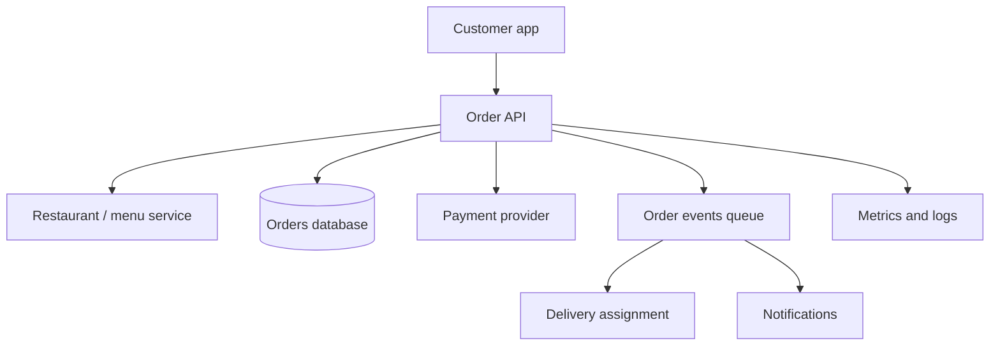


## 2. DNS and HTTP/HTTPS

### DNS
DNS (Domain Name System) resolves a hostname such as `app.example.com` to an IP address. A resolver may use cached records; DNS records have a TTL that influences how long answers may be cached.

Typical request path:
1. User enters `https://app.example.com/products/42`.
2. DNS resolution finds an IP address.
3. The client establishes a network connection to the destination.
4. For HTTPS, TLS authenticates the server and establishes encryption.
5. The client sends an HTTP request; the server returns an HTTP response.

DNS does **not** send the web page itself; it helps the client find where to connect.

### HTTP vs HTTPS
- **HTTP** defines request/response semantics: methods, headers, status codes, and bodies.
- **HTTPS** is HTTP protected by TLS. HTTP is still used in development, internal networks, and some controlled contexts; public production traffic should generally use HTTPS.
- HTTP/1.1, HTTP/2, and HTTP/3 differ in transport and multiplexing details. HTTP/3 uses QUIC over UDP; don't assume every HTTP request is always carried over TCP.

Example request:
```http
GET /api/products/42 HTTP/1.1
Host: app.example.com
Accept: application/json
```

Example response:
```http
HTTP/1.1 200 OK
Content-Type: application/json

{"id": 42, "name": "Keyboard"}
```

Useful status codes: `200` success, `201` created, `400` invalid request, `401` unauthenticated, `403` unauthorized, `404` not found, `429` rate limited, `500` server error, `503` temporarily unavailable.

### Real-life example: opening an online store

A customer opens `https://shop.example.com/products/shoes`.

1. DNS resolves the hostname to an address.
2. The browser establishes a connection and negotiates TLS for HTTPS.
3. It sends an HTTP request for the product page.
4. The server returns HTML or data with a status code and headers.
5. The browser fetches any additional scripts, images, and stylesheets.

If DNS is misconfigured, the browser may not find the service. If TLS certificates are invalid, secure connection setup can fail. A `404` means the requested resource was not found; a `503` usually signals temporary service unavailability.

**Interview takeaway:** DNS locates the destination; HTTPS protects the connection; HTTP defines the request and response.

### Diagram: What happens when a user opens a website

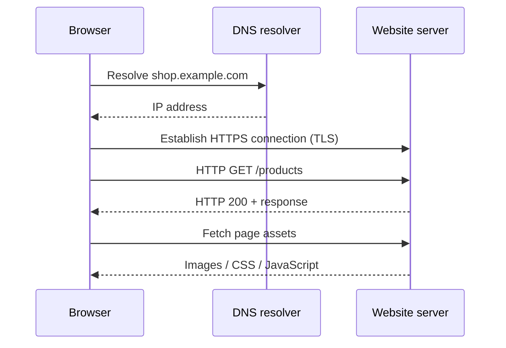


## 3. Vertical vs horizontal scaling

### Vertical scaling (scale up)
Increase the resources of one machine: CPU, RAM, disk, or network capacity.

**Example:** upgrade an API server from 2 vCPU/4 GB RAM to 8 vCPU/32 GB RAM.

- Pros: simple; often no application-level distribution changes.
- Cons: hardware/instance ceiling, potentially expensive upgrades, and a larger single failure domain.

### Horizontal scaling (scale out)
Add more instances and distribute traffic between them.

**Example:** run 6 stateless API instances behind a load balancer.

- Pros: more aggregate capacity, resilience to individual instance failures, and incremental scaling.
- Cons: requires traffic distribution, health checks, observability, and careful handling of shared state.

**Important:** horizontal scaling works best when app instances are stateless. Put shared sessions in a shared store or use signed client-side tokens rather than relying on one server's local memory.

### Real-life example: ticket sales during a concert launch

A ticketing website may receive a sudden traffic spike when sales open.

- **Vertical scaling:** move the application to a larger machine. This is operationally simple, but the machine has a limit and can remain a large failure domain.
- **Horizontal scaling:** add more stateless application instances behind a load balancer. This increases aggregate capacity, provided the database and other dependencies can keep up.
- **What to measure:** CPU, memory, request latency, error rate, database connections, and queue depth.
- **Practical order:** optimize slow requests and queries first, scale the app tier, then address whichever shared dependency becomes the next bottleneck.

**Watch out:** adding API servers will not fix a saturated database or a third-party payment provider.

### Diagram: Scaling a ticketing application

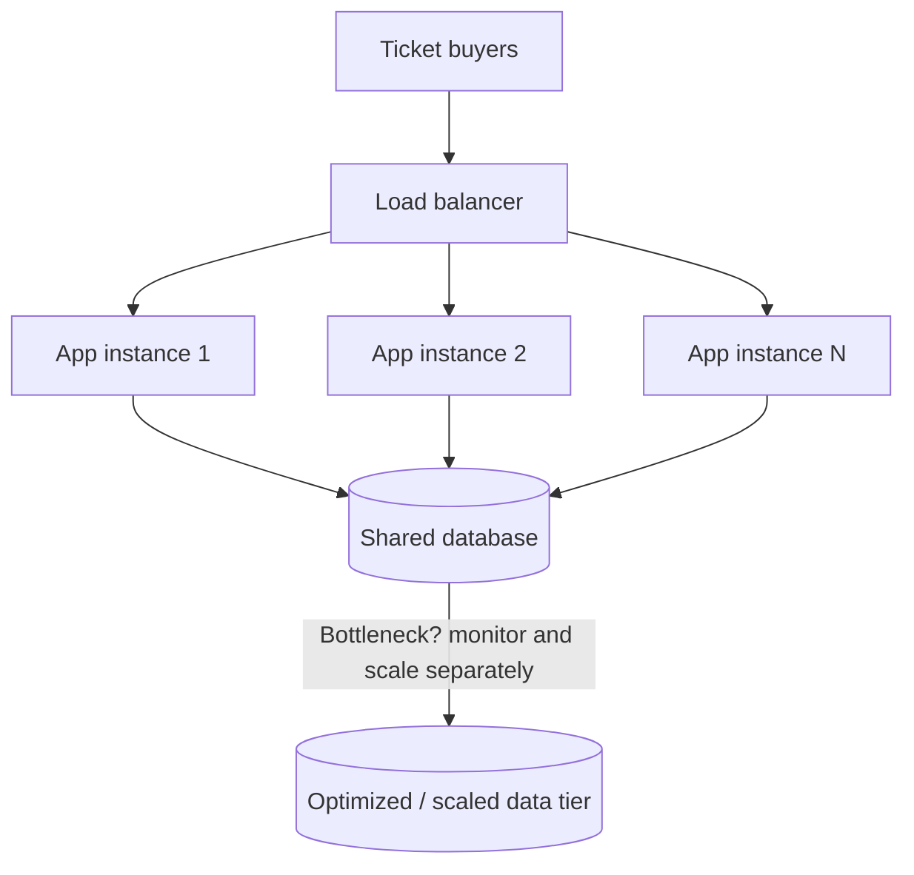


## 4. Load balancers: L4 vs L7

A load balancer provides a stable entry point and distributes connections/requests to healthy backends.

### Common balancing algorithms
- **Round robin:** rotate through servers; works well when requests and server capacities are similar.
- **Least connections:** prefer a server with fewer active connections; useful when connection durations vary.
- **IP hash:** map a client IP to a backend. This can support affinity, but NAT, changing IPs, and uneven client populations can cause imbalance.
- **Weighted routing:** send more traffic to higher-capacity instances.

### L4 vs L7

| Feature | Layer 4 | Layer 7 |
|---|---|---|
| Typical layer | TCP/UDP | HTTP/HTTPS |
| Routing inputs | IP, port, transport connection | Host, path, headers, cookies, HTTP properties |
| Main strength | Low overhead; protocol-level forwarding | Application-aware routing and richer policies |
| Example use | TCP service, high-throughput connection routing | Route `/api` to APIs and `/images` to an image service |

L7 can route `/api/orders` to an order service and `/api/users` to a user service. Both types can support health checks depending on the product.

### Health checks and failure handling
The load balancer probes backends and stops sending new traffic to unhealthy instances. Deploy multiple load-balancer nodes or use a managed, highly available service so the load balancer itself does not become a single point of failure.

**Trade-off:** sticky sessions can simplify legacy stateful apps, but reduce flexibility. Prefer stateless instances or shared session storage where practical.

### Real-life example: routing an online marketplace

An online marketplace has product, checkout, and account APIs.

- An **L4 load balancer** can distribute TCP connections using network-level information.
- An **L7 load balancer or gateway** can route requests such as `/products` to the catalogue service and `/checkout` to checkout, and may apply HTTP-aware policies.
- Health checks remove unhealthy instances from normal routing.
- Multiple healthy instances allow traffic to continue when one instance fails.

**Trade-off:** L7 routing offers richer request-aware rules, while L4 forwarding can be simpler and lower overhead. Neither makes the downstream database highly available by itself.

### Diagram: Network-level and HTTP-aware routing

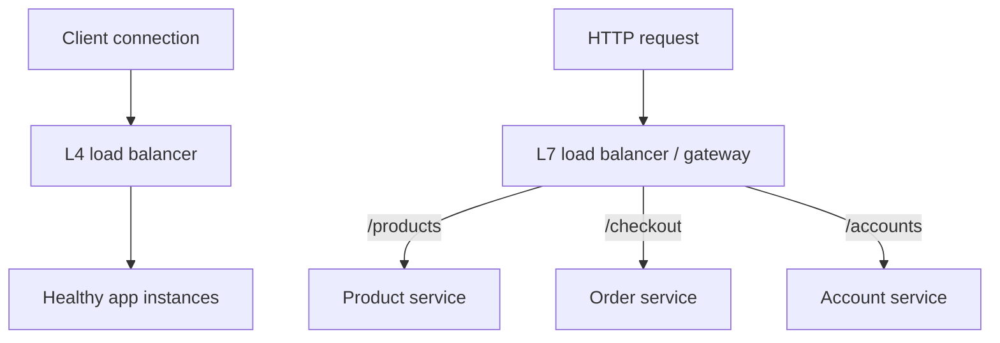


## 5. CDN architecture

A Content Delivery Network (CDN) caches and serves content from edge locations closer to users.

**Typical flow:**
1. A user requests an image, stylesheet, JavaScript bundle, video segment, or cacheable response.
2. The nearby edge checks its cache.
3. On a **cache hit**, it returns the object.
4. On a **cache miss**, it fetches from the origin, caches according to policy, and returns it.

### Why use a CDN?
- Lower latency for geographically distributed users.
- Less bandwidth and load on the origin.
- Better delivery of large static assets and media.
- Some CDN products also offer TLS termination, DDoS protection, and edge rules.

### Cache controls to remember
- Cache-Control headers, TTL, cache keys, invalidation/purging, and versioned asset filenames.
- Do not publicly cache personalized or private responses unless the cache key and policy explicitly make it safe.
- A CDN is not a replacement for database caching or application-level caching; it solves edge delivery.

**Example:** serve `/assets/app.abc123.js` from the CDN, while `GET /api/me` goes to the application and is not shared-cached.

### Real-life example: a video-learning platform

Students in different cities watch the same course videos and download thumbnails.

1. The video or thumbnail is requested from a nearby CDN edge.
2. If the object is cached, the edge serves it without contacting the origin.
3. If it is not cached, the edge fetches it from the origin and may cache it according to policy.
4. Versioned asset names and cache headers control freshness.

A CDN can reduce distance-related latency and origin bandwidth. However, a personalized page containing a student's private course progress must not be shared-cached under an unsafe cache key.

**Interview takeaway:** use a CDN for eligible content near users; use application/data caching for different bottlenecks.

### Diagram: Cacheable video and image delivery

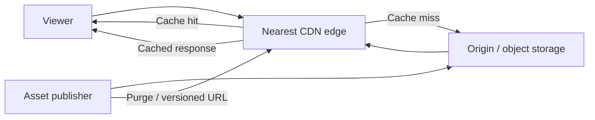


## 6. Redis and caching strategies

Redis is an in-memory data store often used for low-latency caching, counters, rate limits, ephemeral state, and certain queues/coordination patterns. It is not automatically the source of truth for durable business data.

### Cache-aside (lazy loading)
1. Application checks cache.
2. On hit, return the cached value.
3. On miss, query the database.
4. Store the result in cache with a TTL and return it.

Example (Python-like pseudocode):
```python
def get_product(product_id):
    key = f"product:{product_id}"
    value = redis.get(key)
    if value is not None:
        return value

    value = database.fetch_product(product_id)
    if value is not None:
        redis.set(key, serialize(value), ex=300)  # 5-minute TTL
    return value
```

### Common cache write strategies

| Strategy | Write path | Benefit | Risk / cost |
|---|---|---|---|
| Cache-aside | App updates DB and invalidates/refreshes cache | Simple, flexible | Stale values or cache stampede if poorly managed |
| Write-through | Write cache and backing store as part of write path | Cache stays warm and more consistent by design | Added write latency; coordinating failures matters |
| Write-back / write-behind | Write cache first; persist asynchronously | Very fast writes and can batch persistence | Data-loss risk if not durably logged; ordering/recovery complexity |
| Read-through | Cache layer loads missing values from backing store | Simplifies callers | Depends on cache/provider support |

### Eviction and expiration
- **LRU:** evict least recently used items.
- **LFU:** evict least frequently used items.
- **TTL:** expire entries after a configured duration.
- TTL is expiration, not exactly the same as an eviction algorithm; real stores may combine expiration and memory-pressure policies.

### Common cache problems
- **Cache stampede/thundering herd:** many requests miss/expire the same hot key at once and overload the DB. Use request coalescing/single-flight locks, jittered TTLs, stale-while-revalidate, or controlled refresh.
- **Cold cache:** a new/emptied cache sends many misses to the database. Consider warming known hot keys and ramping traffic carefully.
- **Stale data:** define invalidation rules, short TTLs, or versioned keys based on business needs.
- **Hot key:** one key receives disproportionate traffic. Consider local in-process caching, replication, key splitting, or request coalescing.
- **Cache outage:** use timeouts, circuit breakers, and controlled fallback; avoid every request stampeding the DB.

**Interview example:** product catalogue pages can tolerate a short stale window; account balance or authorization decisions may need stronger consistency and should not blindly trust a stale cache.

### Real-life example: an e-commerce product catalogue

Thousands of customers may request the same popular product details.

- The API checks Redis for `product:123`.
- On a cache hit, it returns the cached product data quickly.
- On a miss, it reads the database and caches the result with a TTL.
- When the product price changes, the application invalidates or refreshes the relevant key.

Product descriptions may tolerate a short stale window; stock availability and checkout decisions may need a fresh authoritative check. Add TTL jitter or request coalescing to reduce many simultaneous misses on a popular key.

**Interview takeaway:** cache data that is read often and can safely tolerate the chosen freshness policy.

### Diagram: Cache-aside product lookup

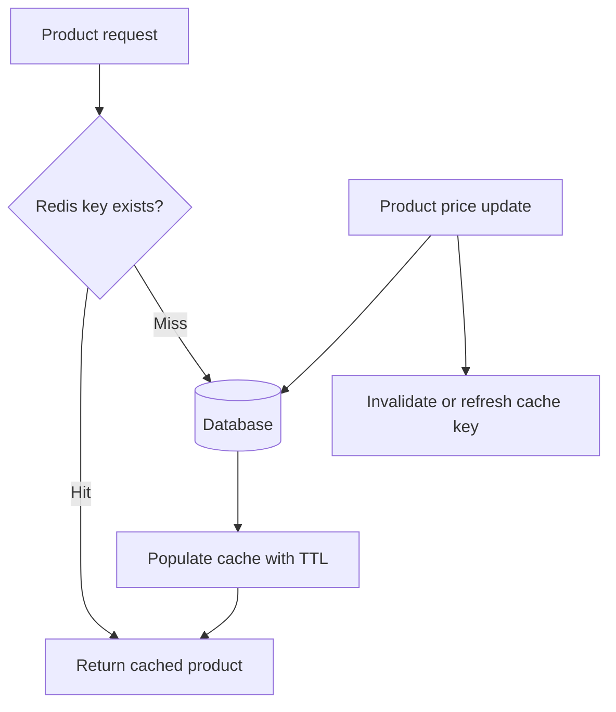


## 7. Database indexing

An index is an auxiliary data structure that helps the database find rows without scanning the entire table. B-tree indexes are common; other index types support different query patterns.

Example:
```sql
CREATE INDEX idx_orders_customer_created
ON orders (customer_id, created_at DESC);

SELECT id, created_at, total
FROM orders
WHERE customer_id = 42
ORDER BY created_at DESC
LIMIT 20;
```

A suitable composite index can help filter by customer and return recent orders in order. Index usefulness depends on the query plan, selectivity, sort, and database engine.

### Trade-offs
- Faster matching reads and sometimes sorting/joins.
- Extra disk/storage and memory use.
- Inserts, updates, and deletes must maintain indexes, so too many indexes slow writes.
- Column order matters for composite indexes. An index on `(customer_id, created_at)` is not generally interchangeable with one on `(created_at, customer_id)`.

Use `EXPLAIN` / `EXPLAIN ANALYZE` (carefully in production) to inspect query plans. An index is not a magic fix for every slow query.

### Real-life example: order history

A customer opens their most recent orders. Without a suitable index, the database may need to inspect many rows and sort matching results.

An index such as `(customer_id, created_at DESC)` can help the database find one customer's newest orders efficiently. Confirm the actual benefit with the query plan and representative data.

- Add indexes for real query patterns, filters, joins, and ordering.
- Avoid creating indexes for every column: indexes consume storage and add write overhead.
- Recheck performance as data volume and query patterns change.

**Interview takeaway:** design the index around the query, then verify it with `EXPLAIN` rather than assuming it helps.

### Diagram: Index-assisted order-history query

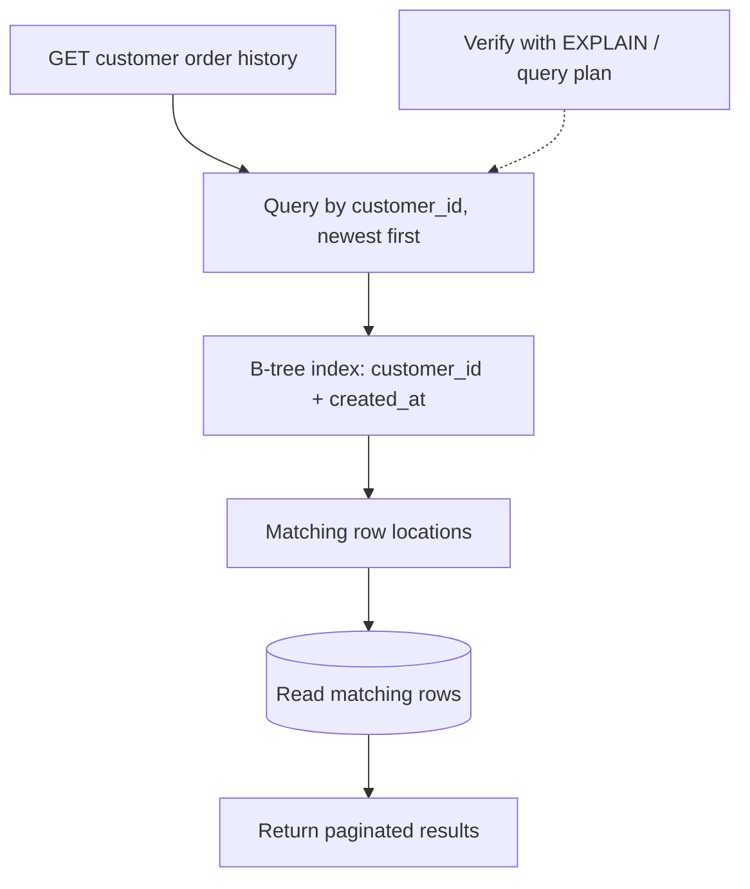


## 8. Replication

Replication copies data from one database node to another.

### Primary/replica pattern
- Primary handles writes.
- Replicas receive changes and can serve reads.
- Failover may promote a replica if the primary fails, using an election/managed failover process.

**Useful when:** read traffic is much higher than write traffic and read capacity or availability needs to grow.

### Key trade-offs
- Replication is not necessarily instantaneous. **Replication lag** means a replica can return stale data.
- If a user updates a record and immediately reads it, route that read to the primary or use a consistency mechanism when read-your-writes behavior is required.
- Failover needs safe leader election, fencing, and recovery procedures to avoid split-brain or lost acknowledged writes.
- Replicas improve read scale and resilience; they do not automatically increase write throughput.

### Real-life example: a social-media feed

A service receives many more feed reads than profile edits.

- A primary database accepts writes and replicates changes to read replicas.
- Feed reads can use replicas when slightly stale results are acceptable.
- After a user changes their profile, a read that must immediately reflect that change can be routed to the primary or use a read-your-writes strategy.

Replication can increase read capacity and provide failover options, but replica lag means replicas may temporarily return old data. Failover also requires safe promotion and recovery procedures.

**Interview takeaway:** replication copies data; it does not automatically distribute writes or guarantee zero data loss.

### Diagram: Primary database and read replicas

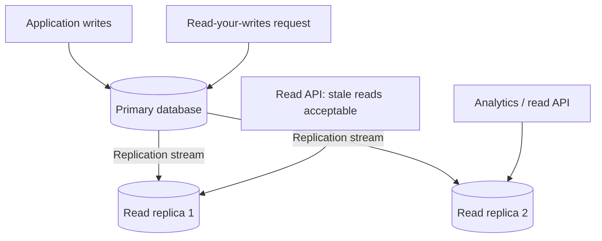


## 9. Sharding

Sharding partitions one logical dataset across multiple database nodes. Each shard stores a subset of the data.

### Common shard-key strategies
- **Range-based:** IDs 1–1M on one shard, 1M–2M on another. Easy range queries, but hot ranges and uneven growth are possible.
- **Hash-based:** hash a key and map it to a shard. Often distributes data more evenly, but range queries become harder.
- **Directory-based:** a lookup service maps keys/tenants to shards. Flexible, but the directory needs availability and scale.

Example concept:
```python
shard_number = hash(user_id) % shard_count
```
This simple modulo example illustrates the idea, but changing `shard_count` can remap many keys. Consistent hashing or an explicit shard map can reduce or control movement.

### Sharding trade-offs
- More storage and write capacity across machines.
- More operational complexity: migrations, rebalancing, cross-shard joins/transactions, unique IDs, and hot shards.
- Choose a shard key with high cardinality and traffic distribution in mind. Avoid keys that send most traffic to one shard.

**Replication and sharding solve different problems:** replication copies a shard for availability/read scale; sharding splits the dataset for capacity. Real systems often use both.

### Real-life example: a multi-tenant SaaS platform

A SaaS product stores projects and audit events for many customer organizations. Over time, one database may no longer meet storage or throughput needs.

- A tenant ID or another carefully selected key can route data to a shard.
- Hash-based placement may spread tenants across shards; a directory-based map can help place large tenants separately.
- Cross-shard reporting and migrations become more complicated.
- A very large or busy tenant can create a hot shard even when the total data is distributed.

Choose the key based on access patterns, tenant size, cardinality, and isolation requirements—not just convenience.

**Interview takeaway:** shard when a single database is a measured capacity bottleneck; plan rebalancing and cross-shard operations early.

### Diagram: Tenant-based data partitioning

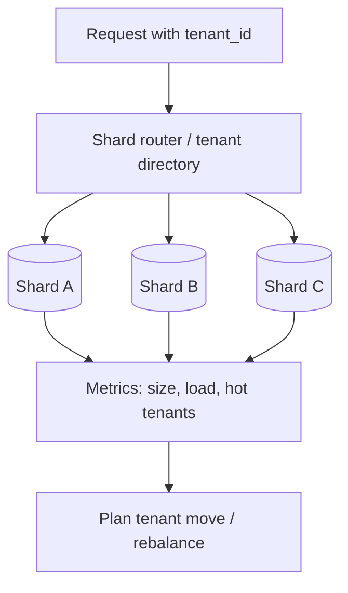


## 10. Consistent hashing

Consistent hashing maps keys and servers onto a conceptual ring. A key is assigned to the next server encountered in ring order. Virtual nodes represent each physical server multiple times to improve distribution.

### Why it helps
With simple `hash(key) % N`, changing the number of servers can remap a large fraction of keys. With consistent hashing, adding or removing a server usually moves only the keys in the affected ring ranges (exact behavior depends on implementation).

Used in distributed caches, partition assignment, and some sharded systems.

**Trade-offs and caveats:**
- Virtual nodes improve balance but do not guarantee perfect balance.
- A good hash function and rebalancing plan matter.
- Consistent hashing does not itself replicate data, guarantee consistency, or automatically handle failed requests; those are separate concerns.

### Real-life example: a distributed cache cluster

An application caches product data across several cache nodes. When a node is added, simple modulo-based placement may send many keys to different nodes, causing a large cache miss spike.

Consistent hashing maps keys and nodes onto a ring so that adding or removing a node generally remaps only a portion of keys. Virtual nodes help improve distribution.

The application still needs a strategy for cache misses, node failures, hot keys, and replication. Consistent hashing alone does not make cached data durable.

**Interview takeaway:** consistent hashing reduces key movement during membership changes; it does not replace replication or failure handling.

### Diagram: Mapping cache keys onto a node ring

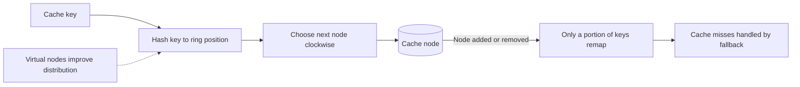


## 11. Message queues and event-driven architecture

A queue decouples the request handler from work that can happen asynchronously.

### Without a queue
A photo upload request may synchronously upload the file, resize it, generate thumbnails, update metadata, and send email. The user waits for every operation; slow work increases latency and failures become tightly coupled.

### With a queue
1. API validates the request and stores the durable input/metadata.
2. API publishes a job/event to a broker.
3. API returns an accepted response (often `202 Accepted`) with a job ID.
4. Workers consume jobs independently: thumbnail worker, email worker, analytics worker, etc.
5. Failed jobs can be retried; repeatedly failing jobs may go to a dead-letter queue.

Example event:
```json
{
  "event_id": "evt_123",
  "type": "photo.uploaded",
  "photo_id": "photo_456",
  "user_id": "user_42"
}
```

### Benefits
- Smooths traffic spikes (the queue buffers work).
- Lets worker pools scale independently.
- Isolates slow or failing downstream operations.
- Supports retries and asynchronous processing.

### Important design details
- A broker acknowledgement does not necessarily mean all business processing is complete.
- Consumers should be idempotent because messages may be delivered more than once.
- Set retry limits and backoff; use dead-letter queues and alerts.
- Monitor queue depth, oldest-message age, processing time, retry rate, and consumer lag.
- Avoid dual-write loss: if DB update succeeds but event publication fails, use an outbox pattern or equivalent reliable publishing strategy.
- Queues improve decoupling, but introduce eventual consistency and operational complexity.

### Real-life example: processing a photo upload

After a user uploads a photo, the API should not make them wait for thumbnail creation, image moderation, analytics, and email notification to finish.

1. The API validates the request and records the upload metadata.
2. It publishes a durable event or job.
3. It returns a response with a photo/job ID.
4. Separate workers generate thumbnails and run other tasks.
5. Transient failures are retried; repeated failures go to a dead-letter queue for investigation.

Use an outbox or another reliable publishing strategy when a database commit and event publication must not drift apart. Consumers should be idempotent because retries and duplicate deliveries can happen.

**Interview takeaway:** queues absorb bursts and decouple slow work, at the cost of eventual consistency and more operational machinery.

### Diagram: Photo-upload job pipeline

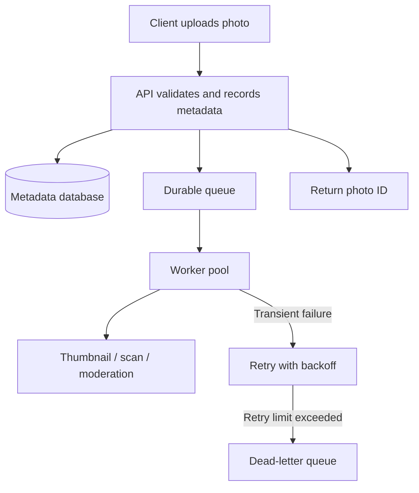


## 12. Kafka vs RabbitMQ

Both are messaging technologies, but their common strengths differ.

| Dimension | Apache Kafka | RabbitMQ |
|---|---|---|
| Core model | Distributed append-only event log with topics and partitions | Message broker with exchanges, queues, and routing |
| Typical fit | Event streams, analytics pipelines, replay, high-throughput fan-out | Task queues, flexible routing, work distribution, request/job messaging |
| Replay | Consumers can often reread retained events by offset | Queue messages are typically removed/acknowledged; replay needs separate design |
| Ordering | Within a partition | Depends on queue and consumer setup; multiple consumers/requeueing can affect order |
| Scaling | Partitioning and consumer groups | Queues, exchanges, clustering/federation patterns; topology matters |
| Key idea | Retained event stream | Broker routes messages to queues |

Neither is universally better. Choose based on delivery semantics, ordering, replay, throughput, routing, latency, operations, and ecosystem.

**Interview shortcut:** Kafka is often a natural fit for durable event streams and replay; RabbitMQ is often a natural fit for routed work queues. Validate against the actual requirements.

### Real-life example: analytics stream versus background task

Suppose an online store needs both to collect a stream of order events for analytics and to send order-confirmation emails.

- **Kafka-style event stream:** retain ordered events in partitions so independent consumer groups can process them and, within retention limits, replay them.
- **RabbitMQ-style work queue:** route jobs to workers that perform tasks such as sending emails, acknowledging successful work and retrying failures according to configuration.

These are typical fits, not hard rules. Compare ordering needs, throughput, replay, routing, delivery guarantees, operations, and existing team expertise before choosing.

**Interview takeaway:** choose based on required behavior and failure semantics, not simply on which tool is more popular.

### Diagram: Event stream and work queue use cases

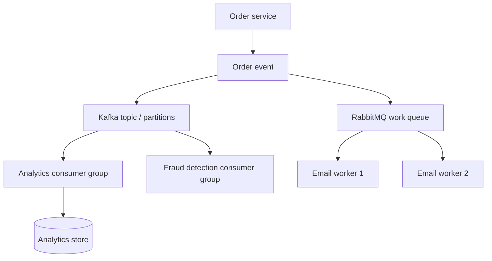


## 13. Blob/object storage (S3)

Object storage is designed for files and binary objects: images, videos, documents, backups, and generated artifacts. Store object bytes in S3-like storage and keep metadata/reference/ownership in the database.

### Why not store large files directly in a relational DB?
It can be done, but often increases database size, backup/restore cost, and pressure on database connections and I/O. Object storage separates large binary delivery from transactional metadata.

### Direct upload with a pre-signed URL
1. Client asks API for permission to upload a file.
2. API authenticates/authorizes the user and creates a short-lived pre-signed URL for a specific object and operation.
3. Client uploads directly to object storage.
4. API records metadata after validating upload completion; a storage event or queue can start processing.
5. CDN may serve public/cacheable content; private downloads can use authorization and short-lived URLs.

Example metadata:
```json
{
  "file_id": "file_123",
  "owner_id": "user_42",
  "object_key": "uploads/user_42/file_123.jpg",
  "content_type": "image/jpeg",
  "status": "uploaded"
}
```

Security checklist: private bucket by default, short URL expiry, restrict object key/method/content type where supported, verify size and actual file type, scan untrusted uploads, and avoid exposing secrets. A pre-signed URL is a bearer credential until it expires.

### Real-life example: uploading a profile photo

A user uploads a large image to a social or collaboration app.

1. The client asks the API for upload permission.
2. The API authenticates the user and creates a short-lived pre-signed upload URL.
3. The client uploads the bytes directly to object storage instead of streaming the whole file through the API server.
4. The service validates the upload and stores metadata and ownership in the database.
5. A worker can resize or scan the file; a CDN can serve approved content according to its access policy.

Keep private buckets private, restrict URL scope and expiry, validate file size and type, and scan untrusted uploads.

**Interview takeaway:** object storage holds large binary objects; the database stores searchable business metadata and references.

### Diagram: Direct, time-limited file upload

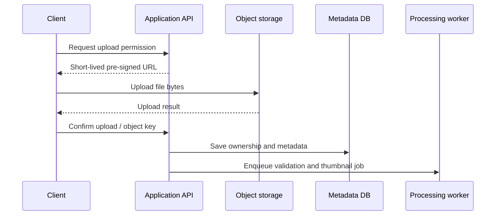


## 14. Rate limiting

Rate limiting protects services from accidental overload, abusive clients, and unfair resource consumption.

### Common algorithms
- **Fixed window:** allow N requests per fixed time window. Simple, but bursts at window boundaries can exceed the intuitive limit.
- **Sliding window/log:** more precise rolling count, with higher state or compute cost depending on implementation.
- **Sliding window counter:** approximate rolling window using current and previous window counts.
- **Token bucket:** tokens refill at a configured rate; requests spend tokens. Supports controlled bursts.
- **Leaky bucket:** smooths output/request rate, often useful to enforce a steady processing pace.

Example policy: allow 100 requests per API key per minute, with a separate stricter limit for expensive endpoints.

### Where to enforce it
- CDN/API gateway for broad edge protection.
- Application for user/tenant-specific business limits.
- Redis can maintain shared counters across multiple app instances.

### Design questions
- Limit by IP, user ID, API key, tenant, or route?
- What happens when the limit is exceeded? Usually return `429 Too Many Requests`, optionally with `Retry-After`.
- How are counters shared across instances?
- What is the policy if the rate-limit store is unavailable?
- Protect against spoofed client IP headers; trust forwarded headers only from known proxies.

### Real-life example: protecting a login API

A login endpoint receives repeated requests from a single IP or account, potentially from a bot or a misconfigured client.

- Apply limits at the edge or API gateway for broad traffic protection.
- Add account- or tenant-aware limits for business fairness.
- Use a shared counter store when limits must be coordinated across multiple API instances.
- Return `429 Too Many Requests` when appropriate, optionally with `Retry-After`.

A single IP limit can affect users behind the same NAT, while account-only limits can be abused against a victim's account. Combine signals carefully, monitor false positives, and avoid leaking whether an account exists.

**Interview takeaway:** define the identity, time window, burst policy, and behavior when the limiter itself is unavailable.

### Diagram: Protecting a login endpoint

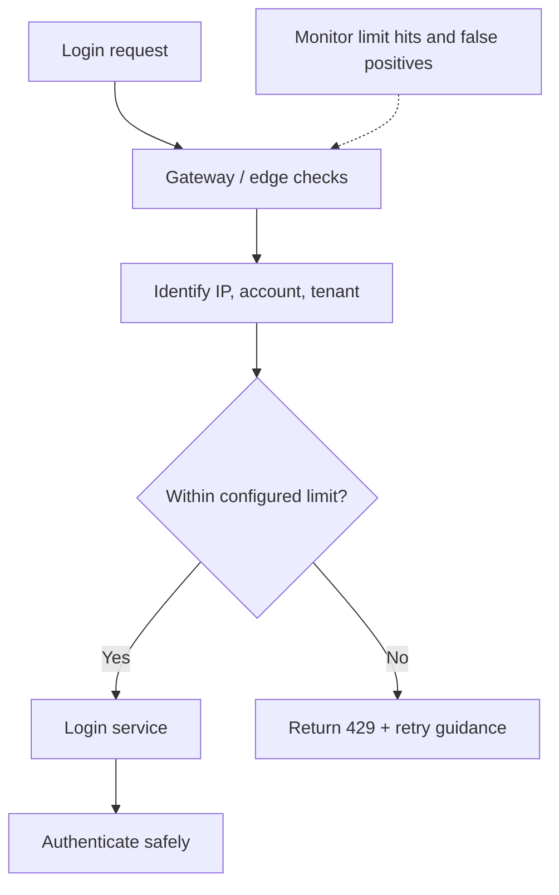


## 15. Polling vs WebSockets

### Polling
Client repeatedly sends HTTP requests asking whether anything changed.

- Simple, stateless, and widely compatible.
- Can waste requests when nothing changes and updates may be delayed by the polling interval.
- Use for infrequent updates or when simplicity is more important than immediacy.

### Long polling
Client sends a request and server holds it until an update or timeout, then the client reconnects. Fewer empty responses, but still has request lifecycle and connection management costs.

### WebSockets
Provides a persistent, bidirectional connection after an HTTP upgrade handshake. Either side can send messages over the connection.

- Good for chat, live collaboration, presence, multiplayer state, and real-time dashboards.
- Requires connection management, heartbeats, authentication, reconnect logic, and horizontal fan-out/pub-sub when many application instances are involved.
- Load balancers/proxies must support the connection behavior; long-lived connections consume resources.

| Need | Likely starting point |
|---|---|
| Data changes rarely | Normal HTTP request |
| Updates every 30–60 seconds are acceptable | Polling |
| Updates are sporadic and client needs low delay | Long polling or WebSockets |
| Continuous bidirectional low-latency updates | WebSockets |

WebSockets do not automatically solve message persistence, delivery guarantees, or broadcasting across servers.

### Real-life example: tracking a food-delivery order

- **Polling:** the app asks every 30 seconds for the latest order status. Simple, but can make many empty requests and delay updates.
- **Long polling:** the server holds a request until a status changes or a timeout occurs, then the client reconnects.
- **WebSockets:** the server can push status updates over a persistent bidirectional connection, useful when updates should appear quickly.

For a low-frequency status page, polling may be sufficient. For live courier movement or chat, WebSockets may be a better fit, but need reconnection logic, authentication, heartbeats, and a way to fan out events across application instances.

**Interview takeaway:** choose the simplest communication pattern that meets the required update latency and interaction model.

### Diagram: Live food-delivery order tracking

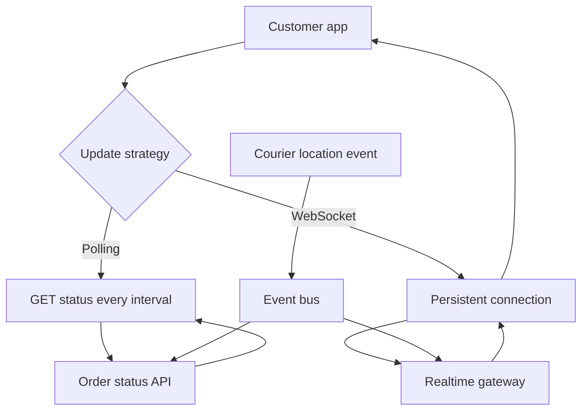


## 16. Idempotency

An operation is idempotent when repeating the same operation has the same intended effect as performing it once.

This matters when clients retry after a timeout: the server may have completed the first request even though the response never reached the client.

### Example: payment API
Client sends:
```http
POST /payments
Idempotency-Key: order-987-payment
Content-Type: application/json

{"order_id":"order-987","amount":2500,"currency":"INR"}
```

Server should atomically associate the key with the request/result. If the same key is retried with the same payload, return the original result instead of charging again. If the same key is reused with a different payload, reject it.

Implementation checklist:
- Scope the key to the customer/operation.
- Store request fingerprint, status, and response/result durably.
- Enforce uniqueness atomically (e.g., unique DB constraint); don't rely only on an in-memory check.
- Define retention/expiry based on retry and business windows.
- Handle concurrent duplicate requests and in-progress status.
- Make downstream side effects idempotent too where possible.

HTTP methods such as PUT and DELETE are defined with idempotent semantics, but a POST endpoint can also implement idempotency with a key. Idempotency is not the same as exactly-once delivery.

### Real-life example: preventing duplicate payments

A customer taps “Pay” and the mobile network times out. The client retries, but the first payment may already have succeeded.

The client sends an idempotency key for that logical payment. The server atomically stores the key, request fingerprint, processing status, and result. A retry with the same key and same payload returns the original result instead of charging again; reusing the key with a different payload is rejected.

Use a durable uniqueness constraint and handle concurrent requests and in-progress results. Also consider idempotency at downstream payment and notification boundaries.

**Interview takeaway:** idempotency makes retries safe at the business-operation level; it is not a blanket guarantee of exactly-once execution.

### Diagram: Safe retry for a payment request

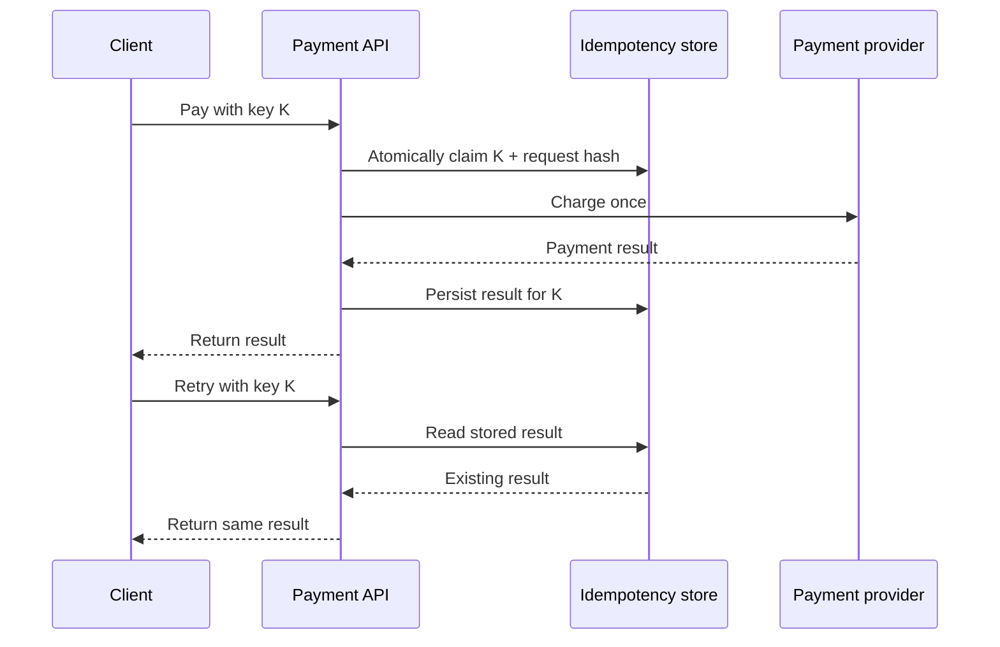


## 17. CAP theorem

CAP describes a distributed data system under a network partition: it cannot guarantee both **linearizable consistency (C)** and **availability (A)** for every request while also tolerating that partition (**P**).

- **Consistency:** every successful read observes the latest successful write according to the chosen strong consistency model.
- **Availability:** every request to a non-failing node receives a non-error response, though the response may not reflect the latest write.
- **Partition tolerance:** the system continues operating despite communication failures between nodes.

When a partition occurs, a design may prefer:
- **CP behavior:** reject, delay, or restrict some operations to preserve strong consistency.
- **AP behavior:** keep responding and allow temporary divergence/stale results, reconciling later.

This is a simplification for interviews; real systems can make different choices per operation, and consistency models are more nuanced than a single label.

**Example:** a social media view count may tolerate temporary stale reads; a bank transfer or inventory reservation may require stronger coordination to avoid incorrect outcomes.

Do not say “choose any two of three” without mentioning the partition scenario. In a distributed system, partitions are a reality to design for.

### Real-life example: inventory during a network partition

Imagine a retailer's inventory service has replicas in two regions and the regions temporarily cannot communicate.

- A **consistency-first** design may reject or delay some stock-reservation requests until it can safely coordinate, reducing the risk of selling the same final item twice.
- An **availability-first** design may keep accepting requests in both regions, but then needs reconciliation and may have to handle overselling or conflicting updates.

The right behavior depends on the operation. Product descriptions can tolerate stale reads more easily than payment authorization or final-item reservation.

**Interview takeaway:** CAP describes a trade-off during a partition, not a universal label that makes every operation in a system either “CP” or “AP.”

### Diagram: Inventory behavior during a network partition

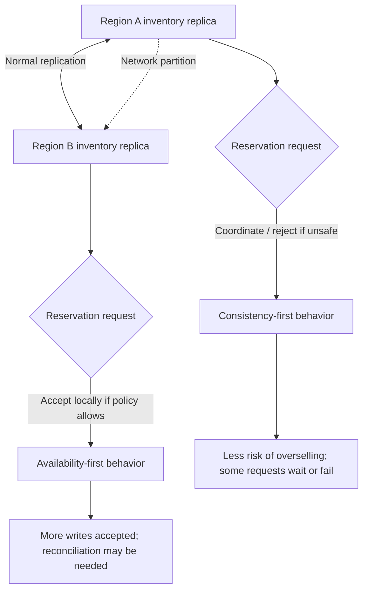


## 18. End-to-end scalable architecture

Imagine designing a photo-sharing service.

```text
Client
  |
  v
DNS -> CDN / Edge protection (static and cacheable content)
  |
  v
Highly available Load Balancer / API Gateway
  |
  v
Stateless API instances
  |             \
  |              +--> Redis cache (hot, safe-to-cache reads)
  |
  +--> Primary DB for writes / read replicas for eligible reads
  |         |
  |         +--> Shards when one DB cannot handle data/throughput
  |
  +--> Durable event/outbox -> Message broker -> Worker pools
  |                                      |--> thumbnail/image processing
  |                                      |--> email/notifications
  |                                      +--> analytics
  |
  +--> Object storage (uploads/downloads via short-lived pre-signed URLs)
```

### Request walkthrough: upload a photo
1. Client resolves the service hostname through DNS and connects over HTTPS.
2. Client requests an upload authorization from the API.
3. API checks identity, tenant permissions, file constraints, and rate limits.
4. API returns a short-lived pre-signed URL; client uploads bytes directly to object storage.
5. Upload completion is verified. Metadata is recorded in the database.
6. A reliable event is published (often through a transactional outbox) to the queue/broker.
7. Workers resize the image, generate thumbnails, and send notifications independently.
8. Worker retries handle transient errors; idempotency prevents duplicate side effects.
9. CDN delivers eligible images/derivatives near users. Private content uses authorization-aware delivery.
10. Metrics and alerts track latency, error rate, queue lag, cache hit ratio, database saturation, and object processing failures.

### Why each component exists

| Problem | Component/pattern | What it improves | Trade-off |
|---|---|---|---|
| Hostname must resolve | DNS | Discovery | Cached answers may take time to update |
| Too much traffic for one app server | Horizontal scale + LB | Throughput and instance resilience | More operations and shared-state concerns |
| Unhealthy instance receives requests | Health checks | Availability | Detection is not instantaneous |
| Distant users have slow static delivery | CDN | Latency and origin bandwidth | Invalidation and cache policy complexity |
| Repeated reads overload DB | Redis/cache | Read latency and DB load | Staleness and cache failure modes |
| Slow query scans many rows | Index | Query efficiency | Storage and write overhead |
| Too much data on one DB | Sharding | Capacity and distributed load | Cross-shard complexity |
| DB node failure/read pressure | Replication | Read scale and failover options | Lag and failover complexity |
| Slow secondary work blocks response | Queue + workers | Async processing and buffering | Eventual consistency, retries, duplicates |
| Large binary payloads burden app/DB | Object storage | Durable, scalable file storage | Access control and lifecycle management |
| Abuse or traffic spikes | Rate limiter | Fairness and overload protection | False positives and shared counter overhead |
| Need live updates | WebSockets/pub-sub | Low-latency two-way updates | Connection/fan-out complexity |
| Client retries duplicate a side effect | Idempotency key | Safe retries | Durable key tracking and retention |

### Important caveats
- A queue acknowledgement should not be confused with a completed business workflow. Return a job/status ID if work continues asynchronously.
- Use a database transaction/outbox or another reliable publishing pattern to avoid losing events between a DB write and a broker publish.
- Replication does not guarantee zero data loss; understand acknowledgement policy, failover, and recovery objectives.
- Don't shard early. Indexing, query improvements, vertical scaling, and read replicas may be sufficient first.
- Keep private files private. CDN caching and pre-signed URLs must follow the authorization model.
- Add observability from the beginning: structured logs, metrics, tracing, SLOs, dashboards, and alerts.

### Real-life example: a photo-sharing service, end to end

A user uploads a photo and friends later view it.

1. DNS resolves the app hostname and HTTPS protects the connection.
2. A load balancer routes the request to a stateless API instance.
3. The API checks identity, permissions, and rate limits.
4. The client uploads photo bytes directly to object storage using a short-lived pre-signed URL.
5. The database stores photo metadata and ownership.
6. A reliable event triggers workers to scan the file and generate thumbnails.
7. A CDN serves eligible derivatives; Redis can cache safe, frequently requested metadata.
8. Metrics and alerts track API latency, errors, queue lag, cache hit ratio, and storage processing failures.

Start with the simplest viable design. Add read replicas, sharding, or additional services only when measurements and requirements justify them.

**Interview takeaway:** be able to trace one request and one piece of data through every component, including what happens when each dependency fails.

### Diagram: Photo-sharing request and background processing

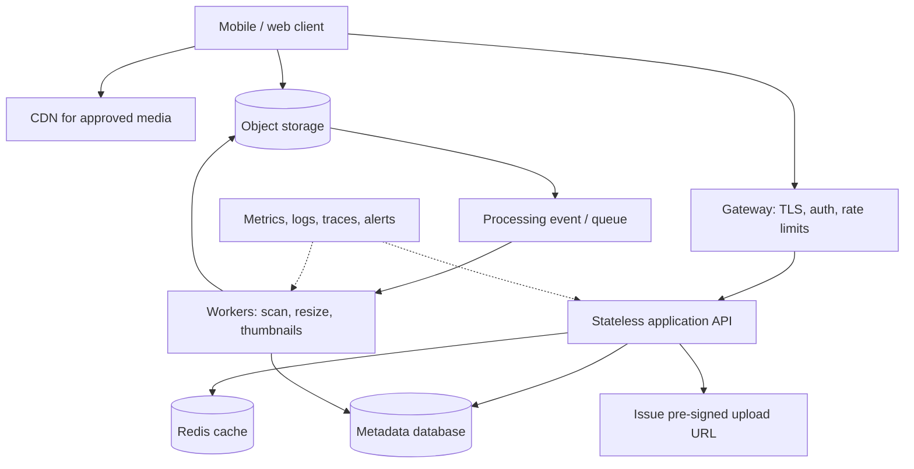


## 19. Trade-off cheat sheet

| Concept A | Concept B | Main distinction |
|---|---|---|
| Vertical scaling | Horizontal scaling | Bigger machine vs more machines |
| L4 LB | L7 LB | Transport routing vs HTTP-aware routing |
| CDN | Redis | Edge delivery for content vs application/data cache |
| Indexing | Sharding | Faster access within a DB vs partitioning data across DB nodes |
| Replication | Sharding | Copies of data vs subsets of data |
| Cache-aside | Write-through | Load on cache miss vs keep cache updated in write path |
| Kafka | RabbitMQ | Retained partitioned event stream vs flexible broker/queue routing |
| Polling | WebSockets | Repeated client requests vs persistent bidirectional connection |
| Synchronous work | Queue + workers | Wait for work vs acknowledge and process asynchronously |
| Idempotency | Exactly-once processing | Safe repeated effect vs much broader end-to-end delivery/processing guarantee |

### Real-life example: choosing a design for a food-delivery service

- **CDN vs Redis:** the CDN serves cacheable images and static assets near users; Redis can cache frequently accessed application data such as restaurant menus.
- **Replication vs sharding:** replicas can add read capacity; shards split the dataset when one database cannot handle the required capacity.
- **Polling vs WebSockets:** polling can suit occasional order-status checks; WebSockets can suit continuous courier-location updates.
- **Synchronous work vs queue:** validate and create an order synchronously when the user needs an immediate result; send non-critical notifications asynchronously.
- **Consistency vs availability:** a menu description can be briefly stale, but order payment and stock reservation need carefully defined correctness rules.

**Interview takeaway:** explain the requirement that drives each choice and the cost introduced by that choice.

### Diagram: Match the component to the need

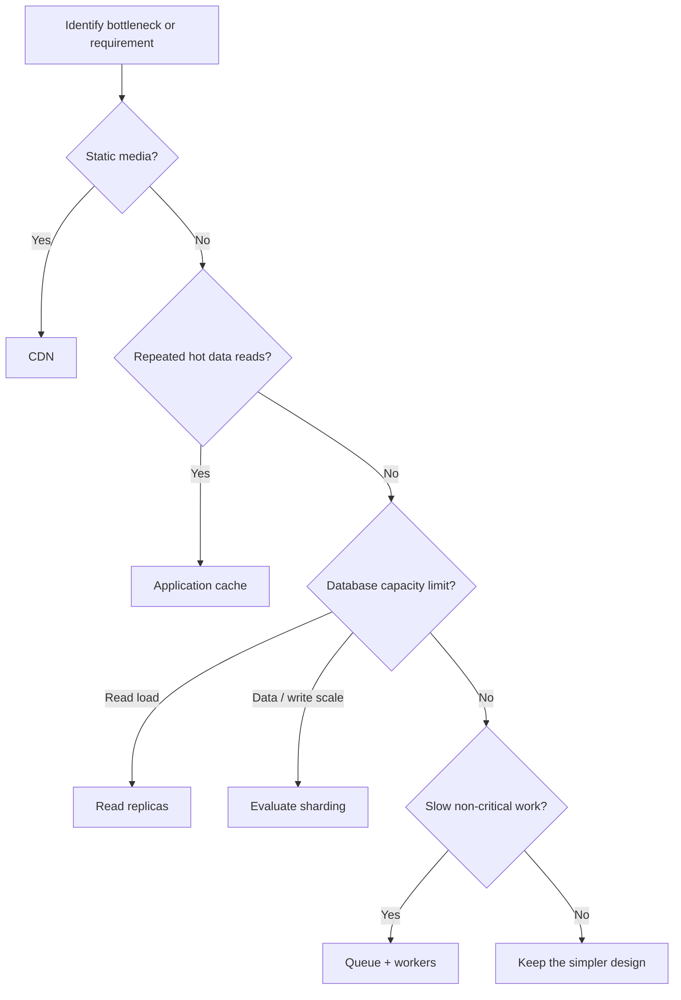


## 20. Interview revision checklist

Before you finish a design, make sure you can answer:

- [ ] What are the main functional and non-functional requirements?
- [ ] What is the estimated read/write traffic, payload size, and data growth?
- [ ] What is the request flow from DNS to the backend and response?
- [ ] What is the first bottleneck, and why is the chosen component appropriate?
- [ ] Which data can be cached, for how long, and how is it invalidated?
- [ ] What are the index and query patterns? Do we actually need sharding?
- [ ] What consistency guarantees do reads need after writes?
- [ ] What happens when a server, database node, cache, broker, or worker fails?
- [ ] Are retries safe? Are consumers idempotent? Is there a dead-letter path?
- [ ] How are large/private files uploaded and delivered securely?
- [ ] What is the rate-limit policy and its failure behavior?
- [ ] What are the key metrics, SLOs, alerts, and recovery objectives?
- [ ] What are the costs and trade-offs of each component?

### A concise answer framework
**Requirement → bottleneck → design choice → request/data flow → failure handling → trade-offs → metrics.**

If you can explain not only *what* a component is but *which problem made you add it*, you have the right mental model for system design interviews.

---

### Real-life example: designing a ride-booking app in an interview

Before drawing boxes, clarify:
- Can riders book, cancel, and track a trip? Can drivers accept or decline?
- What matters most: booking correctness, location freshness, low latency, or regional availability?
- What is the expected peak request rate and read/write ratio?
- Which actions must be strongly coordinated, and which can be eventually consistent?
- How will you prevent duplicate booking/payment requests?
- What happens if a location update, database, queue, or notification service fails?
- Which metrics and alerts tell you that users are experiencing problems?

Then draw the simplest end-to-end flow, identify its first bottleneck, and introduce one component at a time. For every addition, explain the benefit, failure mode, and trade-off.

**Interview answer structure:** requirements → rough scale → API/data model → architecture → bottleneck → failure handling → trade-offs → observability.

### Diagram: Ride-booking system: high-level request flow

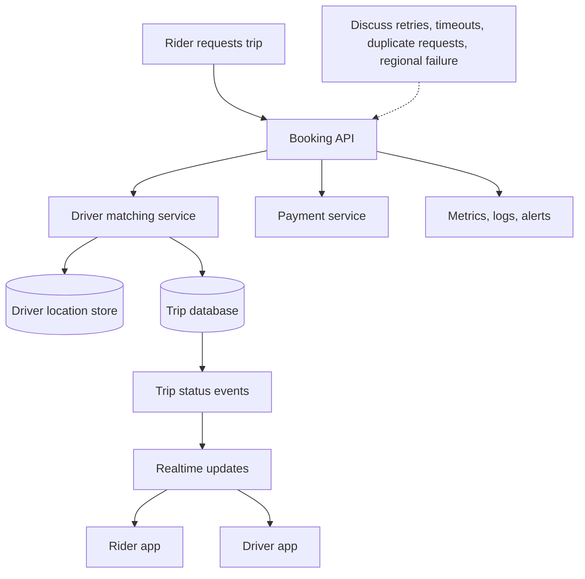


## 21. Visual diagrams

GitHub renders the Mermaid diagrams below directly in this Markdown file. Use them to revise the request flow, caching behavior, and asynchronous processing without leaving the notes.

### 21.1 Typical web request flow

```mermaid
flowchart TD
    U[Client / Browser] --> DNS[DNS lookup]
    DNS --> EDGE[CDN / Edge protection]
    EDGE --> LB[Load balancer / API gateway]
    LB --> API[Stateless API instances]
    API --> CACHE[(Redis cache)]
    API --> DB[(Primary database)]
    DB --> REPLICA[(Read replicas)]
    API --> OBJ[(Object storage)]
    API --> OUTBOX[Transactional outbox]
    OUTBOX --> Q[Message broker]
    Q --> W[Worker pool]
    W --> DB
    W --> OBJ
```

**How to read it:** DNS helps locate the service; the edge serves eligible cached content; the load balancer routes requests; APIs coordinate business logic; databases store structured data; object storage holds large files; workers handle asynchronous tasks.

### 21.2 Cache-aside read path

```mermaid
flowchart TD
    A[Client request] --> B[Application checks cache]
    B -->|Cache hit| C[Return cached value]
    B -->|Cache miss| D[Query database]
    D --> E[Store result with TTL]
    E --> F[Return result]
```

**Remember:** define TTL and invalidation behavior, and protect the database from a thundering herd when popular keys expire together.

### 21.3 Asynchronous job processing

```mermaid
flowchart LR
    C[Client] --> API[API validates request]
    API --> DB[(Persist job / metadata)]
    API --> Q[Durable queue]
    API --> R[Return 202 + job ID]
    Q --> W[Worker]
    W --> S{Processing succeeds?}
    S -->|Yes| DONE[Save result / mark complete]
    S -->|No| RETRY[Retry with backoff]
    RETRY -->|Retry limit reached| DLQ[Dead-letter queue]
```

**Design notes:** return a job/status ID for long-running work, make workers idempotent, set retry limits, and alert on queue depth and oldest-message age. Use an outbox or another reliable publishing pattern when a database write and event publication must stay coordinated.

## 22. Further reading and trusted references

These links provide official documentation or widely used learning resources. Use them to validate details and explore implementation-specific behavior.

### Networking and web fundamentals
- [Cloudflare Learning Center: What is DNS?](https://www.cloudflare.com/learning/dns/what-is-dns/)
- [MDN: An overview of HTTP](https://developer.mozilla.org/en-US/docs/Web/HTTP/Overview)
- [MDN: Transport Layer Security (TLS)](https://developer.mozilla.org/en-US/docs/Web/Security/Transport_Layer_Security)

### Scaling, load balancing, and content delivery
- [AWS: Elastic Load Balancing documentation](https://docs.aws.amazon.com/elasticloadbalancing/)
- [Cloudflare: What is a CDN?](https://www.cloudflare.com/learning/cdn/what-is-a-cdn/)
- [Google Cloud: Autoscaling groups](https://cloud.google.com/compute/docs/autoscaler)

### Caching and databases
- [Redis documentation](https://redis.io/docs/latest/)
- [PostgreSQL: Indexes](https://www.postgresql.org/docs/current/indexes.html)
- [PostgreSQL: Streaming replication](https://www.postgresql.org/docs/current/warm-standby.html)
- [AWS: Database sharding guidance](https://docs.aws.amazon.com/whitepapers/latest/database-caching-strategies-using-redis/database-sharding.html)

### Messaging and object storage
- [Apache Kafka documentation](https://kafka.apache.org/documentation/)
- [RabbitMQ tutorials and documentation](https://www.rabbitmq.com/tutorials)
- [Amazon S3: Pre-signed URLs](https://docs.aws.amazon.com/AmazonS3/latest/userguide/using-presigned-url.html)
- [AWS Prescriptive Guidance: Transactional outbox pattern](https://docs.aws.amazon.com/prescriptive-guidance/latest/cloud-design-patterns/transactional-outbox.html)

### Reliability, APIs, and distributed systems
- [Google Cloud: Rate limiting overview](https://cloud.google.com/architecture/rate-limiting-strategies-techniques)
- [MDN: WebSockets API](https://developer.mozilla.org/en-US/docs/Web/API/WebSockets_API)
- [Martin Kleppmann: Designing Data-Intensive Applications (book)](https://dataintensive.net/)
- [Google SRE Book: Monitoring distributed systems](https://sre.google/sre-book/monitoring-distributed-systems/)

### Interview practice
- [System Design Primer](https://github.com/donnemartin/system-design-primer)
- [ByteByteGo: System design resources](https://bytebytego.com/)
- [High Scalability: Real-world architecture articles](https://highscalability.com/)

**Study tip:** start with the relevant section in these notes, sketch the diagram from memory, then read one reference and explain the component's purpose, failure modes, and trade-offs in your own words.

